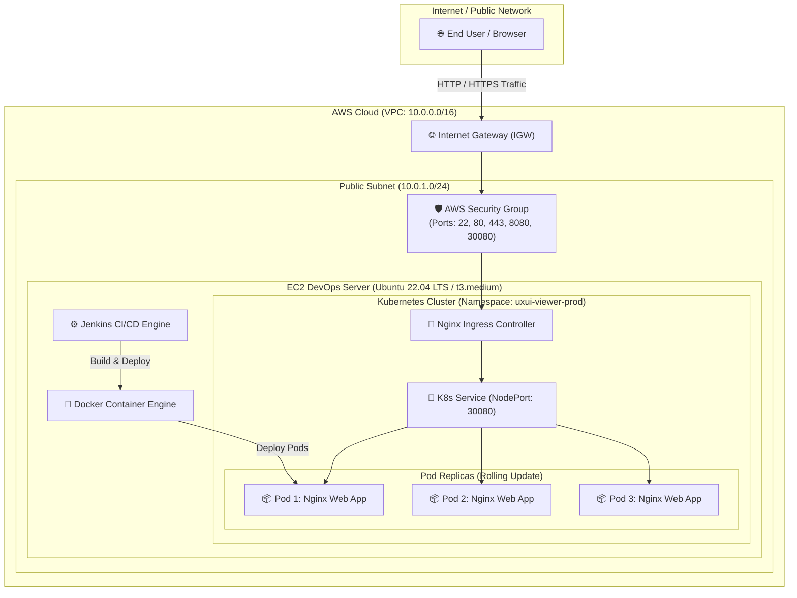

# System & Infrastructure Architecture Documentation

This document explains the cloud infrastructure and container orchestration architecture for the **UX/UI Case Study Viewer** application.

---

## 🏗️ Cloud & Kubernetes Architecture Diagram

---

## 🔍 Architecture Component Breakdown

### 1. Amazon Web Services (AWS) Infrastructure
- **Virtual Private Cloud (VPC)**: Isolated virtual network (`10.0.0.0/16`) providing secure communication between cloud resources.
- **Internet Gateway (IGW)**: Connects the private VPC network to the public Internet.
- **Public Subnet**: Subnet (`10.0.1.0/24`) configured with automatic public IP assignment for external access.
- **Security Group (SG)**: Virtual firewall enforcing strict ingress and egress traffic rules:
  - `22`: Secure Shell (SSH) management access.
  - `80` & `443`: Standard web HTTP and HTTPS traffic.
  - `8080`: Jenkins Web Interface dashboard.
  - `30000-32767`: Kubernetes NodePort high-range service access.

### 2. DevOps Server (EC2)
- **Host Specs**: Ubuntu 22.04 LTS operating system running on an `t3.medium` EC2 instance with 30 GB gp3 SSD storage.
- **Docker Engine**: Manages local container image builds, tagging, and registry authentication.
- **Kubernetes Engine**: Host environment executing the lightweight single-node Kubernetes cluster (Minikube / k3s).

### 3. Kubernetes Orchestration Layer (`uxui-viewer-prod` Namespace)
- **ConfigMap**: Stores non-sensitive application environment variables (`APP_ENV=production`).
- **Deployment (3 Replicas)**: Manages three stateless Nginx pod instances. Implements a `RollingUpdate` strategy (`maxSurge: 1`, `maxUnavailable: 0`) ensuring zero-downtime updates during new releases.
- **Health Checks & Probes**:
  - `Liveness Probe`: Periodically checks `GET /` every 10 seconds. Automatically restarts unresponsive pods (Self-Healing).
  - `Readiness Probe`: Ensures pods are fully booted before receiving traffic.
- **Service (NodePort)**: Exposes internal cluster pods on host port `30080`.
- **Ingress Controller**: Acts as a reverse proxy and HTTP router directing domain requests (`uxui-viewer.local`) to the Kubernetes service.
