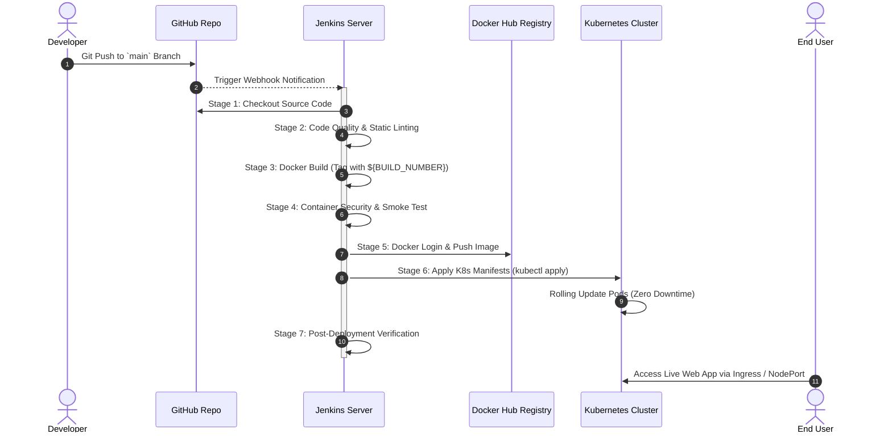

# CI/CD Automated Pipeline Documentation

This document describes the continuous integration and continuous deployment (CI/CD) workflow configured in the `Jenkinsfile` for the **UX/UI Case Study Viewer**.

---

## 🔄 End-to-End Pipeline Sequence Diagram

---

## 🛠️ Jenkins Pipeline Stages Breakdown

| Stage # | Stage Name | Description & Key Commands |
| :--- | :--- | :--- |
| **1** | **Checkout Source Code** | Clones the latest commit from the GitHub repository (`checkout scm`). |
| **2** | **Lint & Code Quality** | Verifies existence and structural integrity of `index.html`, `styles.css`, and `app.js`. |
| **3** | **Docker Build** | Builds an optimized container image tagged with `devopsuser/ux-ui-case-study-viewer:${BUILD_NUMBER}` and `:latest`. |
| **4** | **Security & Smoke Test** | Instantiates a temporary container locally on port 8085, executes `curl` health check to verify HTTP `200 OK`, then tears down container. |
| **5** | **Push to Docker Hub** | Authenticates securely with Docker Hub using Jenkins credentials ID `docker-hub-credentials` and pushes tagged images. |
| **6** | **Deploy to Kubernetes** | Uses Jenkins credentials ID `k8s-kubeconfig` to execute `kubectl apply` for Namespace, ConfigMap, Deployment, Service, and Ingress. Executes `kubectl rollout status`. |
| **7** | **Post-Deployment & Cleanup**| Cleans up workspace workspace artifacts (`cleanWs()`) and outputs success notification. |

---

## 🔐 Credentials & Security Management

> [!IMPORTANT]
> **Zero Hardcoded Secrets**: Secrets such as Docker Hub passwords or Kubernetes kubeconfig files are **never** committed into source code or the `Jenkinsfile`.

1. **Docker Hub Credentials**: Stored in Jenkins Credentials Store under ID `docker-hub-credentials` as a *Username with Password* pair.
2. **Kubernetes Credentials**: Stored in Jenkins Credentials Store under ID `k8s-kubeconfig` as a *Secret File*.
